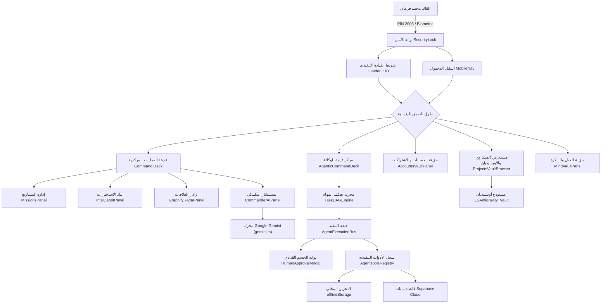

# 🏛️ AQLIYA HQ — التدقيق المعماري الشامل للنظام
## Architectural Intelligence Audit & System Blueprint
**الإصدار:** 1.0.0 (Phase 1 Audit)  
**تاريخ الفحص والتدقيق:** 2026-11-09  
**القائد المستهدف:** محمد قرمان (غزة، فلسطين)  
**الهدف:** توثيق معماري دقيق وشامل للبنية البرمجية الحالية، تدفق البيانات، المكونات، والمنصات لضمان عدم كسر أي وظيفة أثناء التطوير.

---

## 1. نظرة عامة على النظام (System Overview)

نظام **«عقلية | AQLIYA HQ»** هو نظام تشغيل شخصي ذكي (Executive Autonomous Personal OS) يدمج بين:
1. **غرفة عمليات مركزية** لإدارة المهام والمشاريع التكتيكية (NexusOS).
2. **شبكة أفكار واستخبارات معرفية** تصنف المحتوى وتستخرج القيمة العملية.
3. **أسطول وكلاء أذكياء ذاتيين (Agent Swarm)** ينفذون المهام بالتنسيق مع القائد.
4. **مستودع معرفي موحد (Obsidian Master Vault)** يربط كافة مشاريع Antigravity ووثائقها.
5. **معمارية تدعم العمل دون اتصال (Offline-First)** مع مزامنة سحابية هجينة.
6. **دعم متعدد المنصات (Cross-Platform):** يعمل على متصفح الويب، وتطبيق سطح المكتب (Windows Electron)، وتطبيق الهاتف المحمول (Android Capacitor).



---

## 2. المكدس التقني (Technology Stack)

| الطبقة (Layer) | التقنيات المستخدمة | الملاحظات والخصائص |
| :--- | :--- | :--- |
| **واجهة المستخدم (Frontend)** | React 19.3.1, TypeScript 7.0, Vite 8.3 | واجهات حديثة تعتمد على معايير React 19 بدون حزم قديمة |
| **التنسيق والأنماط (Styling)** | Tailwind CSS v4, Lucide React 1.70 | معمارية **Apple Liquid Glass**، خط عقيق الملكي (`Aqeeq Sans Pro`) |
| **إدارة الحالة والتخزين (State & Storage)** | LocalStorage + Supabase Cloud + Realtime WebSockets | بنية Offline-First مع طابور مزامنة محلي `sync_queue` |
| **محرك الذكاء الاصطناعي (AI Engine)** | Google Gemini API (v1beta REST) | نماذج Gemini 3.5 Flash / Lite، مع موجه نظام قيادي غني بالذاكرة |
| **تطبيق سطح المكتب (Desktop)** | Electron 45.2.3, Electron-Builder 26.18 | حزمة ويندوز مستقلة بدون تسريع عتادي لتفادي مشاكل كروت الشاشة |
| **تطبيق الهاتف (Mobile)** | Capacitor Android 8.6.0 | يدعم تلقي المشاركات الخارجية (Android Share Intent)، وبصمة الأصبع |
| **إدارة المعرفة (Knowledge Vault)** | Python 3.12, SQLite 3, Obsidian Markdown | نصوص برمجية تستخرج ملفات ومحادثات Antigravity وتحولها لأوبسيديان |

---

## 3. الهيكل الشجري للمشروع (Project File Tree)

```text
E:\AqliyaHQ
├── android/                      # مشروع Capacitor أندرويد الأصلي (Java/Gradle)
│   ├── app/src/main/
│   │   ├── AndroidManifest.xml   # تعاريف الصلاحيات، وفلتر مشاركة الروابط ACTION_SEND
│   │   └── java/com/aqliya/hq/
│   │       └── MainActivity.java # استقبال النوايا (Intents) وحقن الرابط في نافذة الويب
├── public/                       # الأصول العامة وأيقونات التطبيق والخطوط
│   └── fonts/                    # خط عقيق (Bold, Medium, ExtraLight)
├── src/                          # الشفرة المصدرية لتطبيق React
│   ├── assets/                   # الخطوط والصور الثابتة
│   ├── components/               # مكونات واجهة المستخدم
│   │   ├── agentic-os/           # منظومة تشغيل الوكلاء الذاتيين
│   │   │   ├── AgentFleetCards.tsx      # بطاقات أسطول الوكلاء وحالاتهم
│   │   │   ├── AgenticCommandDeck.tsx   # قمرة قيادة الوكلاء وشريط الأوامر
│   │   │   ├── HumanApprovalModal.tsx   # نافذة الحسم والاعتماد القيادي (HITL)
│   │   │   ├── LiveTelemetryFeed.tsx    # شاشة التتبع والبيانات الحية للوكلاء
│   │   │   └── TaskDAGVisualizer.tsx    # العارض البصري لشبكة مهام الـ DAG
│   │   ├── AccountsVaultPanel.tsx       # خزينة الحسابات والاشتراكات المشفرة
│   │   ├── CommanderAIPanel.tsx         # لوحة المحادثة مع المستشار التكتيكي
│   │   ├── GraphifyRadarPanel.tsx       # رادار العلاقات المعرفية بتقنية Canvas 2D
│   │   ├── HandsFreeVoiceCall.tsx       # واجهة الاتصال الصوتي المباشر بدون يدين
│   │   ├── HeaderHUD.tsx                # الشريط الرأسي الزجاجي الفاخر
│   │   ├── IntelDepotPanel.tsx          # مستودع الاستخبارات والروابط
│   │   ├── MindVaultPanel.tsx           # بنك الذاكرة، الملف القيادي، واستكشاف الذات
│   │   ├── MissionsPanel.tsx            # لوحة المشاريع ومسار NexusOS
│   │   ├── MobileNav.tsx                # شريط التنقل السفلي للهواتف
│   │   ├── ProjectsVaultBrowser.tsx     # مستعرض مشاريع وملفات أوبسيديان
│   │   ├── QuickCaptureModal.tsx        # نافذة التقاط وتصنيف الروابط بالذكاء الاصطناعي
│   │   ├── SecurityLock.tsx             # بوابة القفل برمز 2005 والبصمة
│   │   ├── SettingsModal.tsx            # نافذة الإعدادات ومفتاح Gemini API
│   │   ├── SITREPBriefingModal.tsx      # نافذة إحاطة الصباح والمساء (SITREP)
│   │   └── WatchdogDrawer.tsx           # درج التنبيهات والرقابة الذاتية
│   ├── lib/                      # المكتبات والخدمات الخلفية المحلية
│   │   ├── agentic-os/           # محركات منطق الوكلاء الذاتيين
│   │   │   ├── tools/
│   │   │   │   └── agentToolsRegistry.ts # ترسانة الأدوات التنفيذية للوكلاء
│   │   │   ├── agentExecutionBus.ts      # حلقة التنفيذ المتسلسلة
│   │   │   ├── agentRegistry.ts          # سجل الوكلاء وصلاحياتهم
│   │   │   ├── taskDAGEngine.ts          # محرك تفكيك التوجيه إلى مهام DAG
│   │   │   └── types.ts                  # عقود وتعريفات الوكلاء والمهام
│   │   ├── audio.ts              # محرك الصوت الصامت (Muted Engine) + النطق الصوتي
│   │   ├── commanderDiscovery.ts # بنك أسئلة استكشاف شخصية القائد
│   │   ├── exportMarkdown.ts     # تصدير البيانات إلى Obsidian Markdown
│   │   ├── gemini.ts             # ربط محرك Google Gemini وإدارة السياق
│   │   ├── supabase.ts           # عميل Supabase وإدارة التخزين المحلي والـ Queue
│   │   └── watchdogEngine.ts     # محرك كشف الركود والمخاطر ومتابعة المهل
│   ├── types/                    # تعاريف كائنات النظام وقاعدة البيانات
│   │   ├── database.types.ts     # تعاريف جداول Supabase PostgreSQL
│   │   └── index.ts              # تعاريف الواجهات المشتركة
│   ├── App.tsx                   # المكون الجذري وإدارة الحالة الرئيسية والتنقل
│   ├── index.css                 # الأنماط الزجاجية Apple Liquid Glass وخط عقيق
│   └── main.tsx                  # نقطة الدخول لتطبيق React
├── build_obsidian_vault.py       # نص بايثون لبناء وتحديث خزينة أوبسيديان
├── capacitor.config.json         # إعدادات تطبيق الأندرويد Capacitor
├── electron-main.cjs             # عملية Electron الرئيسية لسطح المكتب
└── package.json                  # الاعتماديات وأوامر البناء
```

---

## 4. تدفق البيانات ومخطط التخزين (Data Flow & Storage Architecture)

النظام مصمم بمعمارية **Local-First & Cloud-Synced**:

1. **القراءة والتهيئة (Initialization):**  
   - يقرأ التطبيق فوراً من `offlineStorage` (مبني على `localStorage`) لتجنب أي شاشات تحميل بيضاء وتوفير سرعة استجابة لحظية (0ms).
   - في الخلفية، يقوم عميل `supabase` بطلب أحدث البيانات من الجداول السحابية:
     - `missions`: المشاريع التكتيكية والخطوات القادمة.
     - `intel_depot`: الروابط والحلول المصنفة.
     - `commander_dossier`: الملف القيادي للقائد محمد.
     - `commander_memories`: بنك الذكريات والملاحظات الدائمة.
     - `strategic_directives`: التوجيهات الاستراتيجية الكبرى.
     - `battle_logs`: سجلات الإنجازات والأحداث.
   - يتم تحديث الذاكرة المحلية `offlineStorage.save()` عند نجاح أي استجابة سحابية.

2. **الكتابة وطابور المزامنة (Write Pipeline & Offline Queue):**  
   - عند تنفيذ أي إجراء (إضافة مهمة، تحديث مشروع، حفظ ذاكرة):
     - يتم تحديث حالة React فورياً في الواجهة (`Optimistic UI Update`).
     - يتم إرسال الطلب إلى Supabase.
     - في حال انقطاع الإنترنت أو فشل الاتصال، يتم تحويل العملية تلقائياً إلى طابور المزامنة المحلي `offlineStorage.queueSyncAction()`.

3. **الاشتراك اللحظي (Supabase Realtime WebSockets):**  
   - قناة `aqliya-realtime-hub` تستمع لأي تغيير يطرأ على جداول المشاريع والذاكرة وتحدث الواجهات دون الحاجة لإعادة تحميل التطبيق.

---

## 5. محرك الذكاء الاصطناعي (Gemini Integration & Prompt Engineering)

- **الملف:** `src/lib/gemini.ts`
- **آلية العمل:**
  1. يقوم بجلب مفتاح API من الإعدادات المحلية `localStorage` أو المتغيرات البيئية أو المفتاح الاحتياطي المشفر.
  2. يقوم بتجميع **سياق استراتيجي ديناميكي** يضم:
     - هوية القائد محمد قرمان ومبادئه الحاكمة من `dossier`.
     - ملخص المشاريع النشطة ونسب إنجازها والخطوة القادمة من `missions`.
     - أحدث الحلول المسجلة في بنك الاستخبارات من `intel_depot`.
     - آخر 15 ذاكرة حاسمة من `commander_memories`.
  3. يرسل الطلب مع تعليمات صارمة للتحدث بلغة عربية قيادية راقية دون حشو.
  4. يحتوي على مصفوفة نماذج بديلة (`CANDIDATE_MODELS`: `gemini-3.5-flash`, `gemini-flash-lite-latest`, ...) لتجاوز أي تعطل طارئ لنموذج معين.

---

## 6. منظومة الوكلاء الذاتيين (Agent Swarm Architecture)

تم بناء أسطول من خمسة وكلاء متخصصين:
1. `chief_of_staff` (Nexus Orchestrator): المستشار وقائد الأركان.
2. `intel_scout` (Depot Scout): وكيل الاستخبارات وتلخيص الروابط.
3. `systems_dev` (Systems Architect): وكيل البناء البرمجي وهندسة الحلول.
4. `watchdog_sentry` (Sentry Watchdog): وكيل الرقابة وكشف الركود والمخاطر.
5. `life_ops` (Life Ops Warden): وكيل العمليات الحياتية والذاكرة.

### آليات العمل المدمجة:
- **محرك تفكيك المهام (`taskDAGEngine.ts`):** يتلقى أمر القائد بلغة طبيعية، ويطلب من Gemini تحويله إلى كائن JSON يحتوي على عقد مهام مترابطة بتبعيات (`dependencies`).
- **حلقة التنفيذ المتسلسلة (`agentExecutionBus.ts`):** تنفذ المهام الجاهزة ذات التبعيات المكتملة بالتسلسل.
- **بوابة الحسم القيادي (HITL Gate):** أي أداة تحمل وسم `requiresApproval: true` (مثل إنشاء مشروع جديد أو اتخاذ قرار مصيري) توقف التنفيذ فوراً وتعرض نافذة تأكيد للقائد للموافقة أو التعديل أو الرفض.

---

## 7. الربط مع مستودع أوبسيديان (Obsidian Vault Integration)

- **المسار على الجهاز:** `E:\Antigravity_Vault`
- **آلية التغذية:**
  - تم بناء سكريبت بايثون `build_obsidian_vault.py` لقراءة قاعدة بيانات محادثات ومشاريع أنتيجرافيتي ونسخ وثائق الماركدون (plans, walkthroughs, lectures) وتصنيفها في مجلدات أوبسيديان المنظمة.
  - تم توفير اختصار تنفيذي على سطح المكتب `Sync_To_Obsidian.bat` لتشغيل المزامنة بنقرة واحدة.
  - تم بناء مكون `ProjectsVaultBrowser.tsx` داخل التطبيق لاستعراض وقراءة هذه الملفات بنقاء وتنسيق زجاجي دون مغادرة التطبيق.

---

## 8. المنصات المدعومة وتوزيع التطبيق (Multi-Platform Build Architecture)

### 1. نسخة الويندوز المكتبية (Electron Desktop):
- يتم تجميع ملفات الواجهة بـ Vite إلى مجلد `dist`.
- يقرأ `electron-main.cjs` ملف `dist/index.html`.
- تم تعطيل التسريع العتادي `app.disableHardwareAcceleration()` لحل أي وميض أو شاشات سوداء على كروت الشاشة.
- النسخة القابلة للتشغيل المباشر جاهزة في `E:\AqliyaHQ\dist-electron\win-unpacked\AqliyaHQ.exe`.

### 2. نسخة الهاتف المحمول (Android Capacitor):
- يتم تصدير ملفات الويب ومزامنتها بـ `npx cap sync android`.
- يدعم `MainActivity.java` فلتر `ACTION_SEND` لالتقاط نصوص وروابط الريلز ومشاركتها مباشرة إلى واجهة التطبيق عبر دالة جافاسكريبت `onAqliyaSharedText`.
- خط بناء أوتوماتيكي متكامل على GitHub Actions يبني حزم `APK` موقعة ويرفعها لإصدارات GitHub Releases عند كل `push`.
