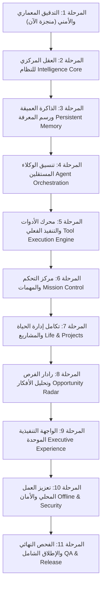

# 🗺️ AQLIYA HQ — خارطة التطوير المعمارية والتنفيذية الشاملة
## Master Development Roadmap (Phases 1 to 11)
**الإصدار:** 1.0.0 (Phase 1 Baseline)  
**تاريخ الاعتماد:** 2026-11-09  
**القائد المستهدف:** محمد قرمان (غزة، فلسطين)  

---

## 🧭 مبادئ وقواعد التنفيذ الصارمة (Mandatory Rules)

1. **العمل على المشروع القائم حصراً:** لا استبدال للمشروع ولا إنشاء مجلدات جديدة.
2. **الحفاظ على المكتسبات والبيانات:** الحفاظ على بيانات Supabase، تكامل Obsidian، تطبيق Windows، تطبيق Android، ونظام الدخول.
3. **لا بيانات وهمية ولا واجهات شكلية:** كل ميزة يجب أن تمتلك محركاً حقيقياً ومنطقاً برمجياً يمكن التحقق منه.
4. **التنفيذ التسلسلي:** لا انتقال لمرحلة تالية قبل توثيق واختبار وتقديم تقرير المرحلة السابقة واعتماد القائد.
5. **استقلالية البنية وتفادي التكاليف:** لا خدمات سحابية مدفوعة إجبارية؛ الاعتماد الكامل على التخزين المحلي والحلول المفتوحة.

---

## 📌 المخطط الزمني للمراحل الإحدى عشرة (Roadmap Overview)

---

## تفاصيل المراحل الإحدى عشرة (Detailed Phase Breakdowns)

### المرحلة 1 — التدقيق المعماري والأمني (Architectural Audit) `[مكتملة]`
- **الهدف:** فحص كافة ملفات ومكونات التطبيق الحالية، وتقييم الأمان والمزامنة، وإنشاء الوثائق المرجعية الأربعة، وحظر تعديل الكود قبل الاعتماد.
- **المخرجات:**
  1. `AQLIYA_ARCHITECTURE.md` (توثيق المعمارية والمكونات)
  2. `AQLIYA_FEATURE_MATRIX.md` (مصفوفة الميزات الفعلية وتحليل الفجوات)
  3. `AQLIYA_SECURITY_AUDIT.md` (التدقيق الأمني ومصفوفة الصلاحيات)
  4. `AQLIYA_DEVELOPMENT_ROADMAP.md` (خارطة التطوير المعتمدة)
- **معيار الانتقال:** اعتماد القائد لتقرير المرحلة الأولى.

---

### المرحلة 2 — العقل المركزي للنظام (Aqliya Intelligence Core)
- **الهدف:** بناء محرك توجيه ذكي ومنطقي برمجياً (`IntelligenceCore`) يتولى معالجة كل أمر من القائد عبر دورة حياة منضبطة من 8 مراحل:
  1. `UNDERSTANDING`: فهم نية القائد وتحديد الهدف الرئيسي.
  2. `CONTEXT RETRIEVAL`: جلب السياق من الذاكرة ذات الصلة فقط.
  3. `PLANNING`: صياغة خطوات الحل وترتيب التبعيات.
  4. `PERMISSION CHECK`: التحقق من مستوى الصلاحيات المطلوب.
  5. `AGENT ASSIGNMENT`: إسناد العمل للوكيل المختص (أو التنسيق بين عدة وكلاء).
  6. `EXECUTION`: تشغيل المهام تباعاً ومراقبة مخرجات كل وكيل.
  7. `VERIFICATION`: فحص النتائج البرمجية والتأكد من مطابقتها للطلب.
  8. `FINAL REPORT`: صياغة تقرير قيادي موجز ودقيق للقائد.
- **الفجوة الحالية:** التطبيق يعتمد حالياً على إرسال نصوص مباشرة لـ Gemini؛ سنبني آلة حالة برمجية واضحة (`IntentRouter & StateMachine`).
- **الاختبار:** اختبار النظام بـ 10 أوامر تكتيكية باللغة العربية تشمل: التخطيط، البرمجة، البحث، إدارة الحياة، والرقابة.

---

### المرحلة 3 — الذاكرة طويلة الأمد ورسم المعرفة (Persistent Memory & Knowledge Graph)
- **الهدف:** تقسيم بنك الذاكرة إلى **7 طبقات تخصصية دقيقة**:
  1. `Identity Memory`: معلومات وهوية القائد وتفضيلاته الصارمة.
  2. `Goal Memory`: الأهداف الاستراتيجية وخطط المستقبل.
  3. `Project Memory`: تفاصيل المشاريع الحالية وحالتها والخطوة القادمة.
  4. `Decision Memory`: القرارات القيادية وأسباب اتخاذها وتاريخها.
  5. `Experience Memory`: الأخطاء السابقة، الدروس المستفادة، ومحطات التعلم.
  6. `Operational Memory`: المهام الحالية، الالتزامات اليومية وسجلات الإنجاز.
  7. `Knowledge Memory`: الأبحاث، المصادر، والروابط المقروءة.
- **بناء الـ Knowledge Graph:** ربط العقد بروابط معرفية فعلية (المستخدم ← الأهداف ← المشاريع ← المهام ← القرارات ← المستندات).
- **الآليات المضافة:** كشف التكرار، اكتشاف التعارضات، البحث السياقي الموجه، وحذف الذكريات بإذن صريح من القائد.

---

### المرحلة 4 — تنسيق الوكلاء المستقلين (Autonomous Agent Orchestration)
- **الهدف:** تحويل أسطول الوكلاء الخمسة إلى منظومة تنفيذ مستقلة ومنسقة:
  - `Agent Registry`: السجل المركزي للوكلاء ببطاقات تعريف وتعيينات واضحة.
  - `Task Dispatcher`: موزع المهام الذكي حسب التخصص ومستوى الصلاحية.
  - `Execution Manager`: مدير التنفيذ الذي يدير المهل الزمنية (Timeouts) وإعادة المحاولة التلقائية (Retries).
  - `Agent Communication Hub`: بروتوكول تبادل البيانات والمعلومات بين الوكلاء.
  - `Verification Engine`: التحقق البرمجي التلقائي من مخرجات كل وكيل قبل الانتقال للخطوة التالية.
- **سيناريو مرجعي للاختبار:** أمر القائد بتحليل إطلاق منتج SaaS، وتوزيع العمل بين (Nexus، Scout، Systems، Life Ops، و Sentry) بتقرير موحد دون تشغيل غير المبرر.

---

### المرحلة 5 — محرك الأدوات والتنفيذ الفعلي (Tool Execution Engine)
- **الهدف:** تمكين الوكلاء من استخدام أدوات تنفيذية حقيقية تتجاوز مجرد تعديل قواعد البيانات:
  - قراءة وثائق المشاريع وملاحظات أوبسيديان (`.md`).
  - البحث الفعلي في ملفات المشاريع على القرص.
  - إنشاء وتعديل الملاحظات والمستندات في مسار `E:\Antigravity_Vault`.
  - تحديث مهام المشاريع وسجلات المعارك.
  - تنفيذ عمليات برمجية منضبطة في بيئة آمنة مقيدة الصلاحيات.
- **الحماية:** لا أوامر نظام تشغيل عشوائية، لا وصول عشوائي لملفات النظام، وموافقة بشرية إجبارية قبل أي تعديل أو حذف.

---

### المرحلة 6 — مركز التحكم والمهمات (Mission Control)
- **الهدف:** واجهة قيادية تنفيذية تعرض الواقع الفعلي لعمليات الوكلاء بدقة متناهية:
  - الوكلاء النشطون، غير النشطين، والمهام الجارية، المكتملة، والفاشلة.
  - شاشة تفاعلية لفتح تفاصيل أي مهمة ومعرفة مدخلاتها، مخرجاتها، واستهلاك الـ Tokens الحقيقي.
  - إمكانية الإيقاف المؤقت، إعادة المحاولة، أو إلغاء التنفيذ بنقرة واحدة.
  - منع تام للأرقام الوهمية أو حالات النشاط المصطنعة.

---

### المرحلة 7 — تكامل إدارة الحياة والمشاريع (Project & Life Intelligence)
- **الهدف:** بناء رابط عضوي وثيق بين أهداف الحياة الشخصية والمشاريع التقنية:
  - **مركز المشاريع:** الأهداف، المهام، المراحل، التقدم، الموارد، المخاطر، والقرارات.
  - **مركز الحياة:** الأهداف الشخصية، العادات، الروتين، الطاقة اليومية، والالتزامات.
  - **الربط التلقائي:** أي هدف شخصي (مثل إطلاق مشروع جديد أو تحسين اللياقة) يتصل بالمهام اليومية والمشاريع التكتيكية وينعكس على جدول الإحاطة الصباحية (SITREP).

---

### المرحلة 8 — رادار الفرص وتحليل الأفكار (Opportunity Radar)
- **الهدف:** تحويل بنك الروابط والأفكار إلى **محرك تقييم استراتيجي صارم**:
  - تحليل الفكرة: المشكلة التي تحلها، المستفيد، الموارد المطلوبة، التكلفة، المخاطر، والبدائل.
  - نظام تقييم موضوعي مبني على 6 معايير: (القيمة، الجهد، التكلفة، المخاطر، الملاءمة الاستراتيجية، وسرعة التنفيذ).
  - عرض أسباب ومنطق التقييم نصياً بدون اختلاق بيانات مالية أو سوقية غير متوفرة.

---

### المرحلة 9 — الواجهة التنفيذية الموحدة (Executive Experience Redesign)
- **الهدف:** توحيد تجربة المستخدم في واجهة أبل الزجاجية الفاخرة (`Apple Liquid Glass`) باللونين الكحلي والزمردي وخط عقيق:
- تنظيم التنقل الرئيسي إلى **10 أقسام تنفيذية واضحة**:
  1. `Command Center` (غرفة التحكم الموحدة)
  2. `AI Assistant` (المستشار التكتيكي المباشر)
  3. `Mission Control` (مركز إدارة الوكلاء والمهام)
  4. `Projects` (إدارة المشاريع ومسار NexusOS)
  5. `Life Intelligence` (الروتين والعادات والأهداف الشخصية)
  6. `Knowledge Vault` (مستعرض ملفات أوبسيديان والمستندات)
  7. `Memory` (الذاكرة السباعية والملف القيادي)
  8. `Opportunity Radar` (رادار الأفكار وتحليل الفرص)
  9. `Accounts Vault` (خزينة الحسابات المشفرة)
  10. `Settings` (إعدادات الأمان ومفاتيح API والمزامنة)
- واجهة رئيسية فائقة الذكاء تعرض: ملخص اليوم، أهم 3 أولويات، المشاريع التي تحتاج تدخلاً، والعمليات المعلقة.

---

### المرحلة 10 — تعزيز العمل المحلي والمزامنة والأمان (Offline, Sync & Security)
- **الهدف:** ضمان الصلابة التقنية والأمان المصرفي:
  - معالجة طابور المزامنة `sync_queue` تلقائياً عند عودة الإنترنت مع كشف تعارضات البيانات (Conflict Resolution).
  - حماية رمز الدخول `2005` عبر تجزئة مشفرة بدلاً من النص العادي.
  - تشفير أسرار الحسابات محلياً بتقنية `AES-GCM`.
  - استخدام التخزين الآمن للمفاتيح (`safeStorage` في الويندوز و `EncryptedSharedPreferences` في الأندرويد).

---

### المرحلة 11 — الفحص النهائي والاعتماد الشامل (QA & Production Release)
- **الهدف:** إجراء اختبارات شاملة ومكثفة لجميع أجزاء النظام:
  - التحقق من دورة عمل الوكلاء، الذاكرة، الصلاحيات، واسترجاع أوبسيديان.
  - فحص أداء الواجهة ودعم اتجاه النص العربي (RTL) بالكامل.
  - التحقق من استقرار تطبيق الويندوز وتطبيق الأندرويد.
  - إصدار تقرير الجاهزية النهائي مع بناء حزم التوزيع الإنتاجية.
