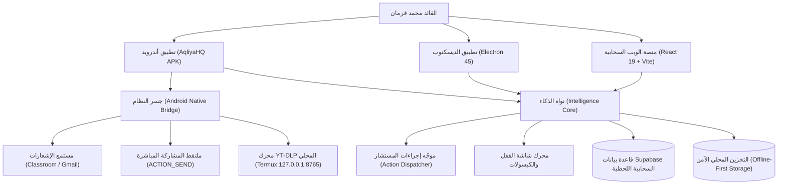

# 🦅 دليل تشغيل ومرجع نظام عقلية التكتيكي المتكامل (AQLIYA HQ — System Manual)
> **الإصدار:** v1.0.0 (Build Release) | **المنصات:** Android APK • Desktop Electron • Progressive Web App  
> **المالك والموجّه:** القائد محمد قرمان (غزة، فلسطين) | **المحرك:** Gemini 3.5 & 2.5 Flash Cascade + Local Termux Daemon + Supabase

---

## 📑 فهرس المحتويات
1. [الرؤية وفلسفة النظام المعمارية](#1-الرؤية-وفلسفة-النظام-المعمارية)
2. [المعمارية التقنية والهجينة (Architecture Overview)](#2-المعمارية-التقنية-والهجينة)
3. [شاشة القفل التكتيكية الفاخرة (Luxury Lockscreen HUD)](#3-شاشة-القفل-التكتيكية-الفاخرة)
4. [محرك المشاركة الذكية ورادار الاستخبارات (Smart Share & Intel Radar)](#4-محرك-المشاركة-الذكية-ورادار-الاستخبارات)
5. [جسر كلاس روم ورسائل البريد الجامعية (Academic & Classroom Bridge)](#5-جسر-كلاس-روم-ورسائل-البريد-الجامعية)
6. [المستشار الذكي ذو الوصول الشامل (Autonomous AI Advisor & Action Dispatcher)](#6-المستشار-الذكي-ذو-الوصول-الشامل)
7. [غرفة العمليات ونظام إدارة الحياة والمشاريع (War Room & Life OS)](#7-غرفة-العمليات-ونظام-إدارة-الحياة-والمشاريع)
8. [نظام التحديثات المبتكر ذو القنوات الثلاث (3-Channel In-App Updater)](#8-نظام-التحديثات-المبتكر-ذو-القنوات-الثلاث)
9. [خط أنابيب البناء السحابي المؤتمت (CI/CD & GitHub Actions)](#9-خط-أنابيب-البناء-السحابي-المؤتمت)
10. [دليل الإعداد والتشغيل السريع (Quickstart & Setup Guide)](#10-دليل-الإعداد-والتشغيل-السريع)

---

## 1. الرؤية وفلسفة النظام المعمارية

**عقلية HQ (AQLIYA HQ)** ليس مجرد تطبيق لإدارة المهام، بل هو **نظام تشغيل معرفي وتكتيكي وتنفيذي متكامل (Cognitive & Tactical Operating System)** صُمم خصيصاً ليرافق القائد محمد قرمان في قيادة حياته ومسيرته المهنية والجسدية والأكاديمية من غزة الصامدة:

* **السرعة الصفرية (Zero-Latency):** واجهات فائقة الخفة والاستجابة، حفظ لحظي Offline-First، وتفاعل صوتي حي بدون لمس الشاشة.
* **السيادة والخصوصية (Zero-Server Phone Independence):** تشغيل العمليات الحساسة (مثل استخراج صوت وبيانات الفيديو وفك القيود) محلياً على هاتف الأندرويد نفسه دون الحاجة لخوادم وسيطة أو لابتوب يعمل في الخلفية.
* **الشمولية غير المقيدة:** إتاحة الوصول الشامل للذكاء الاصطناعي لتعديل أي جزء من النظام ذاتياً بناءً على أوامر صوتية أو نصية سريعة.



---

## 2. المعمارية التقنية والهجينة

تم بناء النظام وفق أفضل معايير هندسة البرمجيات الحديثة لعام 2026:

| الطبقة / المكون | التقنيات المستخدمة | الدور الرئيسي |
|---|---|---|
| **الواجهة الأمامية (Frontend)** | React 19.3 • TypeScript 7 • Tailwind CSS 4 • Lucide Icons • Glisse UI | واجهات مستخدم زجاجية فاخرة (Apple Glassmorphism) تدعم الوضع الداكن والليلي بالكامل مع دعم فائق للغة العربية (RTL). |
| **محرك بناء الويب** | Vite 8 • Rolldown Bundler | تجميع فائق السرعة في أقل من 5 ثوانٍ مع دعم كامل للـ Code-Splitting. |
| **منصة الهواتف المحمولة** | Capacitor 8.6 • Android SDK 35/36 • Java 21 | تطبيق أصيل (Native Android) يمتلك صلاحيات الوصول للعتاد، الإشعارات الدائمة، والتقاط مشاركات النظام. |
| **منصة سطح المكتب** | Electron 45 • Electron Builder | تطبيق ديسكتوب خفيف مستقل لنظام Windows. |
| **الذكاء الاصطناعي** | Google Gemini 3.5 Flash & 2.5 Flash Cascade | تحليل الفيديوهات، المكالمة الصوتية الحية، إدارة الأولويات، وتفكيك المهام الأكاديمية. |
| **قاعدة البيانات والسحابة** | Supabase (PostgreSQL + Realtime WebSockets) | مزامنة لحظية متعددة الأجهزة لبيانات الرادار، المشاريع، ودفتر الملاحظات. |
| **المعالجة المحلية** | Python 3 • YT-DLP • FFmpeg • Termux Android | تفريغ صوتيات الفيديوهات وفك قيود المنصات على الهاتف مباشرة. |

---

## 3. شاشة القفل التكتيكية الفاخرة (Luxury Lockscreen HUD)

تم تصميم وتطوير هذه الشاشة لتطابق شاشات القفل الأكثر فخامة (المستوحاة من إطلالات دبي وبرج خليفة الزجاجية)، وهي مقسمة إلى واجهتين متكاملتين يتم التبديل بينهما بسلاسة:

```
+-------------------------------------------------------------+
|  06:15  -  سبت 10 أكتوبر                                    |
|  [ ن 5 ] [ ث 6 ] [ ر 7 ] [ خ 8 ] [ ج 9 ] ( س 10 ) [ ح 11 ]   |
+------------------------------+------------------------------+
| 🗂️ مهم (4)                   | 🔥 مهم وعاجل (2)             |
| • تمرين                      | • الرد على الإيميلات         |
| • قراءة 10 صفحات             | • اللحاق بالطائرة 18:00      |
| • تخطيط الأسبوع (غداً)       |                              |
+------------------------------+------------------------------+
| ≡ يوماً ما (3)               | ⚡ عاجل (5)                   |
| • ترتيب طلعة نهاية الأسبوع   | • استلام الشحنة 16:00        |
| • ترتيب صور الجوال           | • الرد على رسائل الفريق      |
| • ترتيب الدولاب 5 نوفمبر     | • شراء أغراض (18 أكتوبر)     |
+------------------------------+------------------------------+
| [📷 كاميرا]             ( • • )                 [🔦 كشاف]   |
+-------------------------------------------------------------+
```

### الميزات الجوهرية لشاشة القفل:
1. **الساعة الزجاجية ثلاثية الأبعاد (3D Frosted Glass Clock):** أرقام عملاقة بدقة وتوهج سينمائي عائم، مع تاريخ اليوم باللغة العربية الفصحى.
2. **الواجهة الأولى — مصفوفة أيزنهاور 4x4 وشريط الأسبوع:**
   * **شريط الأيام التكتيكي:** يعرض أيام الأسبوع من اليمين لليسار، مع تمييز اليوم الحالي بحلقة بيضاء عاكسة، وعرض مؤشرات المهام الملونة أسفل كل يوم.
   * **مربع مهم وعاجل (🔥):** للمهام المصيرية والمواعيد الحرجة (أحمر / برتقالي).
   * **مربع مهم (🗂️):** للمهام الاستراتيجية وبناء الذات والقراءة والتمارين (أزرق).
   * **مربع عاجل (⚡):** للشحنات والرسائل السريعة والمشتريات (كهرماني / أصفر ذهبي).
   * **مربع يوماً ما (≡):** للأفكار والمشاريع المؤجلة وترتيب الملفات (رمادي فخري).
3. **الواجهة الثانية — كبسولات سنة 2026 والتقويم الشهري الكامل:**
   * **كبسولات تقدم السنة (Year Progress 77%):** 12 أنبوبة كبسولية تحمل الحروف الأولى لأشهر السنة باللغة العربية (`ي ف م آ م ي ل غ س ك ب د`)، توضح مقدار ما انقضى من السنة والأيام المتبقية (83 يوماً).
   * **التقويم الشهري التفاعلي الكامل (أكتوبر 2026):** شبكة تقويم كاملة لشهر أكتوبر تحتوي على شارات المهام الملونة المنسقة (وردي للرحلات والمناسبات العائلية، أزرق للاجتماعات وتطوير الأعمال، أخضر زمردي للرياضة والبادل واليوغا، وذهبي للمشتريات والمهام المالية).
4. **قناة إشعارات أندرويد الدائمة (`moha_luxury_channel`):**
   * إشعار دائم لا يُحذف (Ongoing Sticky Notification) يظهر مباشرة على شاشة قفل جوالك الفعلية، يُحدّث تلقائياً كلما تم إنجاز أو تعديل مهمة من مهام المصفوفة.
5. **أزرار العتاد السريعة:** زر تشغيل الكشاف الفوري وزر الكاميرا بتصميم دائري زجاجي مع مؤشرات التبديل بنقاط السحب.

---

## 4. محرك المشاركة الذكية ورادار الاستخبارات (Smart Share & Intel Radar)

أحد أقوى الأنظمة الحصرية في تطبيق عقلية HQ؛ يتيح للقائد حفظ وتحليل وتصنيف أي رابط أو فيديو أو فكرة مباشرة من هاتفه:

### 1. الاستقبال عبر قائمة المشاركة الرسمية (Android Native Share):
بمجرد الضغط على زر "مشاركة" (Share) داخل تطبيقات:
* **Instagram Reels**
* **TikTok**
* **YouTube & YouTube Shorts**
* **X (Twitter)**
* **متصفحات الويب والمقالات التقنية**

يقوم نظام `MainActivity.java` بالتقاط الرابط والكابشن المرفق تلقائياً وفتحه داخل التطبيق دون الحاجة لنسخ ولصق يدوي.

### 2. محرك المعالجة الثنائية الفائق (Dual-Engine Processing):
* **المسار الأول (توربو محلي 100% On-Device):** يفحص التطبيق وجود محرك `moha-ytdlp-daemon.py` العامل عبر Termux على المنفذ المحلي `http://127.0.0.1:8765/extract`. وفي حال توفره، يتم استخراج العنوان الحقيقي، الكابشن، صاحب القناة، والصوت بدون أي استهلاك لسيرفرات أو قيود حظر.
* **المسار الثاني (السحابي والاحتياطي الذكي):** في حال عدم تشغيل Termux، يعتمد التطبيق فوراً على بروتوكولات `oEmbed` و `Microlink` واستدعاء سريع لنموذج **Google Gemini** لاستخراج ملخص دقيق وعنوان ذكي في ثوانٍ معدودة.

### 3. التصنيف المتوازن عبر 6 مجالات حيوية:
حرصاً على ألا يقتصر الحفظ على جانب واحد، يقوم المحرك بتصنيف كل محتوى آلياً إلى أحد المجالات التالية:
1. 💻 **برمجة وأدوات تقنية (Dev & Tools)**
2. 💼 **أعمال ومشاريع (Business & Nexus)**
3. 🏋️ **رياضة وصحة وتغذية (Fitness & Calisthenics)**
4. 🧠 **عقلية وتطوير ذات (Mindset & Discipline)**
5. 🤖 **ذكاء اصطناعي وأتمتة (AI & Automation)**
6. 🌐 **مواقع واستكشافات عامة (General Tools)**

### 4. مستودع الاستخبارات وقاعدة البيانات المرنة:
* حفظ مرن غير قابل للضياع (Offline-First عبر LocalStorage المتين مع المزامنة مع Supabase).
* خيارات كاملة لكل بطاقة استخباراتية: تعديل العنوان والتصنيف، فتح الرابط بلمسة واحدة، أو حذف المحتوى بسهولة.

---

## 5. جسر كلاس روم ورسائل البريد الجامعية (Academic & Classroom Bridge)

لضمان عدم تفويت أي تكليف دراسي أو اختبار جامعي، تم بناء جسر متقدم يربط إشعارات النظام مباشرة بعقل التطبيق:

### كيف يعمل الجسر الأكاديمي؟
1. **خدمة أندرويد الأصيلة (`MohaNotificationListenerService`):**
   * تراقب إشعارات شريط الحالة الصادرة من تطبيقات `Google Classroom` و `Gmail`.
   * تفرز الرسائل الأكاديمية والتكليفات من خلال الكلمات المفتاحية (`تكليف`, `واجب`, `امتحان`, `تسليم`, `اختبار`, `assignment`, `due`).
2. **الترحيل الفوري لواجهة التطبيق:**
   * تقوم الدالة `MainActivity.dispatchNotificationToWeb` بضخ تفاصيل التكليف مباشرة إلى الواجهة عبر الجافاسكريبت.
3. **التحليل الذكي والجدولة:**
   * يستخرج المحلل اسم المساق (المادة)، عنوان الواجب، وتاريخ الاستحقاق (Deadline).
   * يضيف التكليف آلياً إلى مصفوفة شاشة القفل التكتيكية (ضمن قسم "مهم وعاجل" أو "عاجل" بحسب القرب الزمني للتسليم).

---

## 6. المستشار الذكي ذو الوصول الشامل (Autonomous AI Advisor)

المستشار ليس مجرد روبوت محادثة نصي؛ بل يمتلك **وصولاً وصلاحية تنفيذية مباشرة (Autonomous Action Dispatcher)** داخل كود وبيانات التطبيق:

### 1. الصلاحيات الذاتية للمستشار (دون الحاجة لتحديث الكود أو تعديل يدوي):
بمجرد أن يطلب القائد من المستشار أمراً صوتياً أو نصياً، يقوم المحرك [advisorActionDispatcher.ts](file:///E:/AqliyaHQ/src/lib/advisorActionDispatcher.ts) بتنفيذه فوراً:
* **تعديل النوم والاستيقاظ:** (مثال: *"سجل إني نمت الآن"* أو *"صحيت الآن"*، يقوم بحساب ساعات النوم ومؤشر الاستشفاء).
* **تعديل الداش دروب (DashDrop):** إضافة وتحديث الملاحظات التكتيكية السريعة.
* **إدارة المشاريع:** إضافة مشروع جديد، تغيير حالة مشروع، أو تحديث أولويات خطة العمل.
* **تعديل هدف المرحلة وشاشة القفل:** (مثال: *"بدي أركز الفترة هاي على إغلاق صفقات نيكسيس"*، فيقوم بتحديث نص وشعار كبسولة الهدف في شاشة القفل فوراً).
* **إضافة وحذف مهام المصفوفة:** توزيع المهام في مربعات أيزنهاور وتحديث إشعار الأندرويد تزامناً مع الأمر.

### 2. وضع المكالمة الصوتية الحية (Hands-Free Voice Call):
* وضع اتصال صوتي تفاعلي كامل متاح في الزاوية العلوية للتطبيق.
* تواصل صوتي فوري ثنائي الاتجاه باللغة العربية مع ميكروفون حساس ومؤشرات موجية حية للتحدث والتفكير والاستماع.

---

## 7. غرفة العمليات ونظام إدارة الحياة والمشاريع (War Room & Life OS)

مركز السيطرة الشامل للقائد محمد لإدارة كافة جوانب اليوم والنمو:

```
+---------------------------------------------------------------------------------+
|                                AQLIYA COMMAND HUD                               |
| [⚡ النبض: 100%]  [🎯 تركيز اليوم: 4h 30m]  [🌙 النوم: 7h 45m]  [📶 Supabase: متصل] |
+---------------------------------------------------------------------------------+
| • رادار شبكة الأفكار التفاعلي (Graphify Knowledge Graph)                        |
| • نظام نيكسيس القانوني (NexusOS Legal SaaS) — متابعة العقود وأول 3 عملاء       |
| • تتبع اللياقة والتضخيم (Calisthenics Tracker — 3000 Kcal / هدف 70 كجم)        |
| • استوديو صناعة المحتوى وقسم التفريغ الأكاديمي                                   |
+---------------------------------------------------------------------------------+
```

### الأقسام التنفيذية الرئيسية:
1. **رادار شبكة الأفكار التفاعلي (Graphify Radar):** شبكة رسومية بصرية تفاعلية تربط المشاريع بالأفكار والروابط الاستخباراتية في فضاء ثنائي وثلاثي الأبعاد.
2. **نظام متابعة مشاريع نيكسيس (NexusOS):** متابعة خطة إطلاق البرنامج المحاسبي والقانوني، ونماذج الفواتير، واستهداف أول عملاء في السوق.
3. **نظام اللياقة البدنية ومؤشر الاستشفاء:**
   * متابعة تمارين الكاليسثنكس والوزن المستهدف (70 كجم).
   * عداد السعرات الحرارية اليومية (3000 سعرة).
   * مسجل ساعات النوم الذكي لحساب مؤشر صفاء الذهن اليومي.
4. **المؤثرات الصوتية التكتيكية (Tactical Soundscapes):** أصوات تحفيزية، ترددات تركيز، وتنبيهات أيزنهاور مدمجة لتعزيز التركيز العالي (Deep Work).

---

## 8. نظام التحديثات المبتكر ذو القنوات الثلاث (3-Channel In-App Updater)

لتفادي أي مشاكل مستقبلية في تحديث التطبيق على الجوال، تم بناء نظام تحديثات مبتكر عبر [OfficialUpdaterModal.tsx](file:///E:/AqliyaHQ/src/components/mobile/OfficialUpdaterModal.tsx) يدعم 3 خيارات مختلفة:

1. **القناة 1 — التحديث الرسمي المباشر بضغطة زر (Direct GitHub APK):**
   * يفحص التطبيق أحدث إصدار منشور على GitHub Releases.
   * يقوم بتنزيل ملف الـ APK وتثبيته مباشرة على الهاتف بنقرة واحدة.
2. **القناة 2 — البث السحابي المباشر (Live Web Cloud Stream — بدون APK):**
   * يتيح للجوال تشغيل أحدث نسخة من التطبيق مباشرة عبر رابط الكلاود السحابي بدون الحاجة لإعادة تثبيت أي ملف APK عند الرغبة في رؤية التعديلات الفورية.
3. **القناة 3 — جسر المطور عبر الواي فاي (Local Wi-Fi Dev Bridge):**
   * إمكانية ربط تطبيق الجوال مباشرة بسيرفر التطوير المحلي على شبكة الواي فاي المنزلية برقم الآي بي (مثل `192.168.1.X:5173`) للتعديل المباشر برؤية لحظية للتغييرات (Hot-Reload).

---

## 9. خط أنابيب البناء السحابي المؤتمت (CI/CD & GitHub Actions)

تم إعداد وضبط وتصحيح ملف سير العمل [.github/workflows/build-apk.yml](file:///E:/AqliyaHQ/.github/workflows/build-apk.yml) ليضمن استقرار بناء التطبيق 100%:

### خطوات البناء المؤتمتة عند كل `git push`:
1. سحب الكود وضبط بيئة `Java JDK 21` و `Node.js 22`.
2. تثبيت الحزم وحزم أندرويد SDK 35/36 وقبول التراخيص تلقائياً.
3. بناء واجهات الويب الإنتاجية باستخدام Vite والتأكد من خلوها من أي أخطاء.
4. مزامنة ملفات أندرويد عبر Capacitor CLI.
5. تجميع ملف الأندرويد الأصيل عبر Gradle (`./gradlew assembleDebug`).
6. إنتاج وتسمية حزمة التطبيق الرسمية `AqliyaHQ-Android-v1.0.apk`.
7. إنشاء إصدار رسمي مؤرخ (GitHub Release) ونشر ملف الـ APK ليكون متاحاً للتحميل المباشر.

---

## 10. دليل الإعداد والتشغيل السريع (Quickstart & Setup Guide)

### 1. تشغيل التطبيق على أجهزة الحاسوب والويب:
```bash
# الانتقال لمجلد المشروع
cd E:\AqliyaHQ

# تثبيت الحزم
npm install --legacy-peer-deps

# تشغيل بيئة التطوير السريعة (Vite)
npm run dev

# تشغيل تطبيق الديسكتوب المستقل (Electron)
npm run app
```

### 2. تفعيل محرك YT-DLP التوربو على الجوال (في خطوة واحدة عبر Termux):
افتح تطبيق **Termux** على هاتفك الأندرويد والصق الأمر التالي:
```bash
curl -sSL https://raw.githubusercontent.com/moqrwled-cell/AqliyaHQ/main/scripts/setup-termux.sh | bash
```

### 3. تحميل أحدث نسخة APK رسمية على هاتفك:
🔗 **[تحميل مباشر لأحدث حزمة AqliyaHQ-Android-v1.0.apk من GitHub Releases](https://github.com/moqrwled-cell/AqliyaHQ/releases/latest)**

---
*تم إنشاء هذا الدليل ليكون مرجعاً تكتيكياً وهندسياً خالداً لنظام عقلية HQ — حفظك الله ووفقك لما يحبه ويرضاه يا قائد محمد.*
