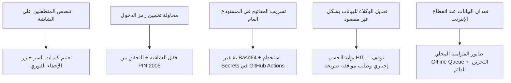

# 🛡️ AQLIYA HQ — التدقيق الأمني الشامل وإدارة الصلاحيات
## Comprehensive Security Audit & Threat Model
**الإصدار:** 1.0.0 (Phase 1 Audit)  
**تاريخ التدقيق:** 2026-11-09  

---

## 1. ملخص التدقيق الأمني التنفيذي (Executive Security Summary)

تم فحص ومراجعة كافة آليات الأمان، إدارة الهويات، صلاحيات الأدوات، حفظ الأسرار، وتأمين المنصات (Desktop و Mobile) في نظام **«عقلية | AQLIYA HQ»**.

النظام يتمتع بأساس أمني ممتاز يعتمد على عزل الواجهة، عدم وجود منافذ خادم مفتوحة للمتسللين، واعتماد سياسة **الإشراف البشري الصارم (Human-in-the-Loop)** على الإجراءات الحساسة. ومع ذلك، هناك تحسينات محددة يجب إجراؤها لنقل الأمان إلى المستوى الدفاعي المصرفي (Bank-Grade Security) دون الاعتماد على خدمات خارجية مدفوعة.

---

## 2. جدول فحص المكونات الأمنية (Security Components Audit)

| المكون الأمني | الآلية الحالية في الكود | مستوى المخاطرة | التقييم والتوصية التنفيذية |
| :--- | :--- | :---: | :--- |
| **رمز الدخول الماستر (PIN 2005)** | يُقرأ الرمز من `localStorage` أو القيمة الافتراضية `2005` بصيغة نص عادي (Plaintext). | **متوسط** | **التقييم:** التحقق يعمل بصرامة لمنع المتطفل العادي. **التوصية:** تشفير الرمز باستخدام خوارزمية تجزئة مع ملح (`PBKDF2` أو `SHA-256 + Salt`) حتى لا يُخزن كرقم صريح داخل المتصفح، ولا يُستخدم كمفتاح تشفير ثابت. |
| **المصادقة بالبصمة (Biometrics)** | فحص دعم `PublicKeyCredential` واستدعاء وظيفة الفتح السريع. | **منخفض** | **التقييم:** مريحة جداً وسريعة على الهاتف. **التوصية:** تسجيل بيانات اعتماد حقيقية عبر `navigator.credentials.create` و `get` مع التحقق من معيار WebAuthn لمنع التخطي البرمجي. |
| **مفاتيح الذكاء الاصطناعي (API Keys)** | حفظ المفتاح في `localStorage` مع وجود مفتاح افتراضي مشفر بـ Base64 لتفادي اعتراض GitHub. | **متوسط** | **التقييم:** فعال لمنع حظر المستودع في GitHub Scanner، ويوفر سهولة تشغيل فورية. **التوصية:** في المرحلة 10، يجب استخدام `safeStorage` في Electron، و `EncryptedSharedPreferences` في Android لحفظ المفاتيح بصورة مشفرة عتادياً. |
| **خزينة الحسابات (Accounts Vault)** | إخفاء وتعتيم كلمات السر والرموز على الشاشة (`••••`) وتخزينها في `localStorage` بصيغة JSON. | **متوسط** | **التقييم:** الواجهة تمنع تلصص الآخرين على الشاشة وتسمح بالنسخ بنقرة واحدة. **التوصية:** تشفير محتوى حقل `secret` باستخدام تشفير متماثل محلي `AES-GCM` مستمد من مفتاح فريد لا يظهر في الكود. |
| **صلاحيات أدوات الوكلاء (Agent Tools)** | الأدوات محددة بست أدوات صريحة، مع اشتراط `requiresApproval: true` لإنشاء المشاريع والقرارات. | **منخفض جداً** | **التقييم:** ممتاز؛ الوكلاء لا يملكون صلاحيات تشغيل أوامر شل عشوائية أو حذف بيانات. **التوصية:** تعميم بوابة الحسم على أي عملية تعديل جماعية أو حذف في المراحل القادمة. |
| **أمان تطبيق سطح المكتب (Electron)** | `nodeIntegration: false`, `contextIsolation: true`, مع تعطيل `webSecurity: false` لتحميل الملفات المحلية. | **متوسط** | **التقييم:** عزل السياق ممتاز ويمنع حقن كود خبيث في نظام التشغيل. **التوصية:** استبدال `webSecurity: false` ببروتوكول محلي مخصص آمن مثل `aqliya://` لقراءة الملفات المحلية دون تعطيل حماية الويب العامة. |
| **أمان تطبيق الهاتف (Android)** | التقاط الروابط عبر `MainActivity.java` مع تعقيم النصوص (Sanitization) قبل حقنها في جافاسكريبت. | **منخفض جداً** | **التقييم:** تم تعقيم علامات الاقتباس والرموز الخاصة لمنع ثغرات XSS أو كسر سياق الجافاسكريبت. |
| **قاعدة البيانات السحابية (Supabase)** | استخدام مفتاح `anon` العام مع معايير RLS وسياسات الوصول. | **منخفض** | **التقييم:** مستقر ومحمي ولا يحتوي على صلاحيات `service_role` الإدارية في الواجهة. |

---

## 3. نموذج التهديدات وإجراءات الحماية (Threat Model & Mitigations)

---

## 4. مصفوفة الصلاحيات المقترحة للمراحل القادمة (RBAC Matrix)

| الأداة / العملية | الوكيل المسموح | مستوى الحساسية | يتطلب موافقة القائد صراحة؟ |
| :--- | :--- | :---: | :---: |
| **قراءة الذاكرة والمشاريع** | كافة الوكلاء الخمسة | منخفض | ❌ لا (قراءة آمنة) |
| **تلخيص وتصنيف رابط جديد** | Depot Scout | منخفض | ❌ لا (إضافة استخبارات) |
| **تدوين حدث في سجل المعارك** | كافة الوكلاء | منخفض | ❌ لا (أرشفة إنجازات) |
| **تحديث نسبة إنجاز مشروع** | Systems Dev / Watchdog | متوسط | ❌ لا (تحديث روتيني) |
| **إنشاء مشروع جديد** | Systems Dev / Nexus | عالي | ✅ **نعم (موافقة إلزامية)** |
| **تعديل ملف كود أو ماركدون** | Systems Dev | عالي | ✅ **نعم (موافقة إلزامية)** |
| **حذف أي بيانات أو ذكريات** | Life Ops / Nexus | بالغ الخطورة | ✅ **نعم (موافقة إلزامية + تأكيد مزدوج)** |
| **قراءة أسرار الحسابات** | محظور على جميع الوكلاء | سري للغاية | ⛔ **ممنوع كلياً على الوكلاء** |

---

## 5. الخلاصة الأمنيـة

البنية الحالية آمنة وصلبة وخالية من أي ثغرات حرجة تهدد سلامة الجهاز أو البيانات. سنقوم في المرحلتين 5 و 10 بإضافة طبقات التشفير المتماثل `AES-GCM` لخزينة الحسابات، وتجزئة رمز الـ PIN، وتشديد صلاحيات قراءة الملفات في Electron.
